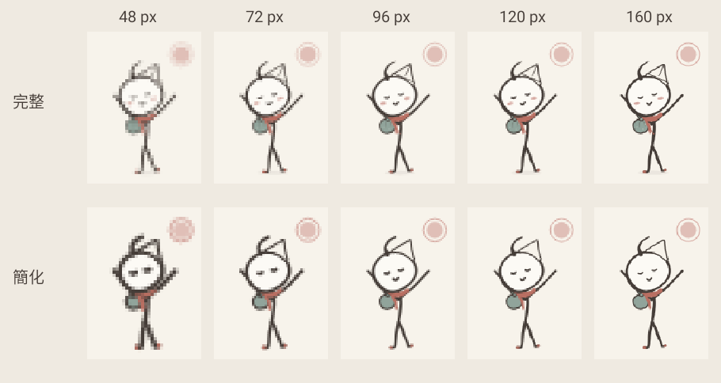
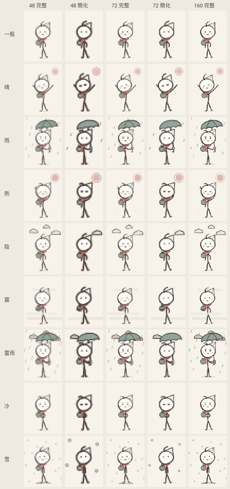
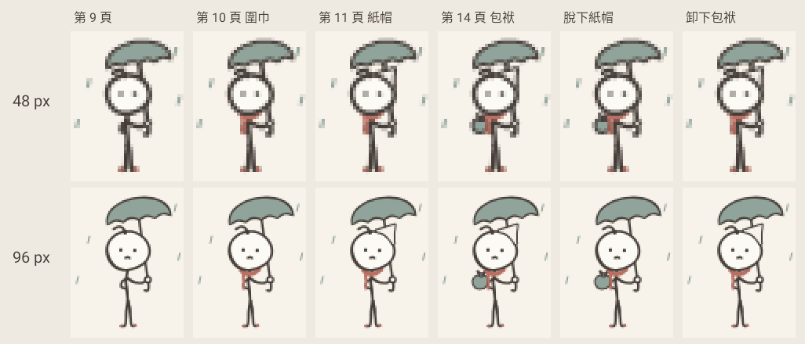
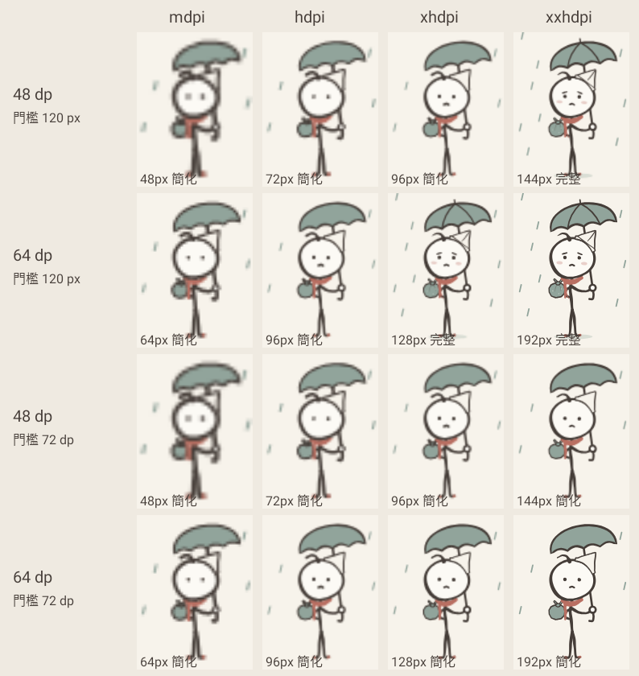
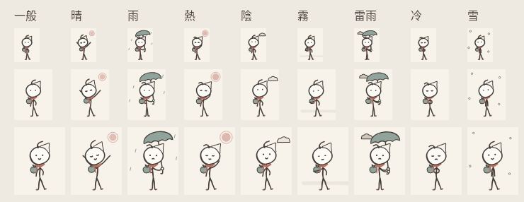

# 墨丸 V3 — P5-2 小尺寸簡化對照圖

CI：[Build APK #59](https://github.com/patty60723/tearoff-calendar/actions/runs/40267853636)（commit `87e62e0`）。Robolectric 用 App 的繪圖程式畫的，不是實機截圖。
每一格都先**真的畫成那個像素大小**，再用最近鄰放大（看得到每個像素）；`actual-pixels.png` 是沒放大的實際大小。
規則與數據見 [實作計畫 P5-2](https://github.com/patty60723/tearoff-calendar/blob/feature/mowan-weather-poses/docs/character-implementation-plan.md)。

## 1. 48／72／96／120／160 px（上：完整版，下：簡化版；晴天、第 14 頁）

## 2、5. 每種天氣：簡化前／簡化後（48、72 px；最右是 160 px 完整版參考）

## 3. 紙帽、圍巾、包袱的有無（雨天，48／96 px 簡化）

## 4. 同一個視覺大小在不同密度（上兩列：門檻 120 px；下兩列：門檻 72 dp，建議）

## 實際像素（不放大）：每種天氣 48／72／96 px 簡化版

