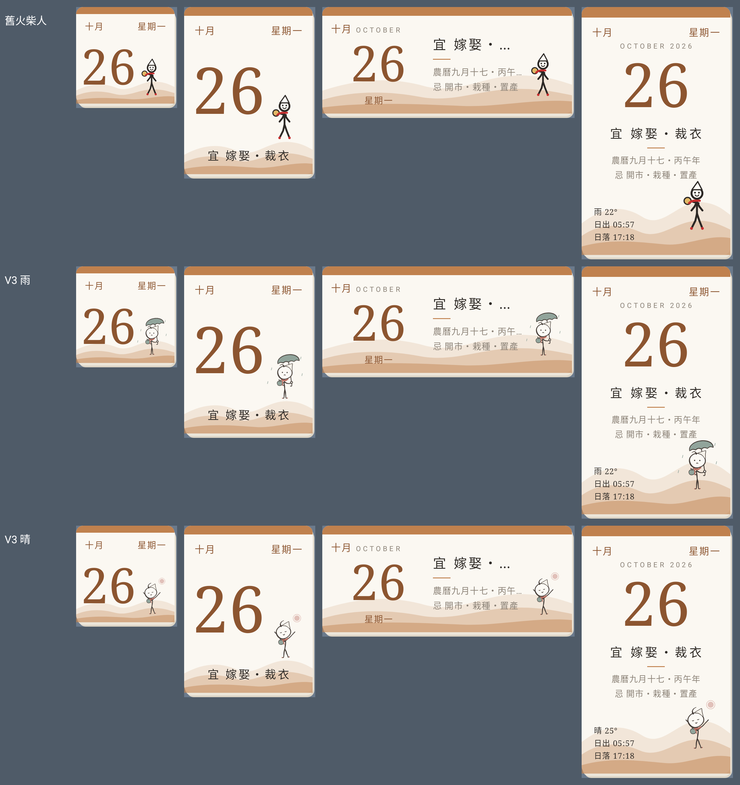
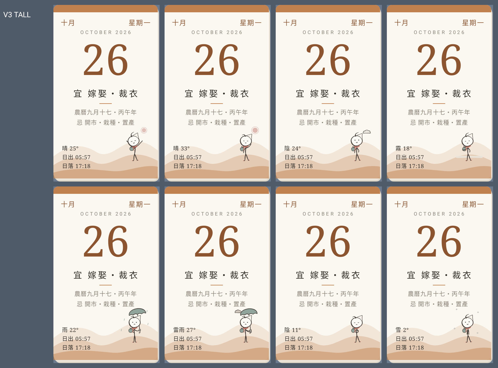
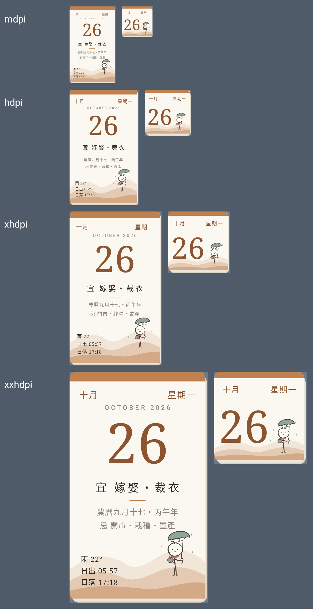
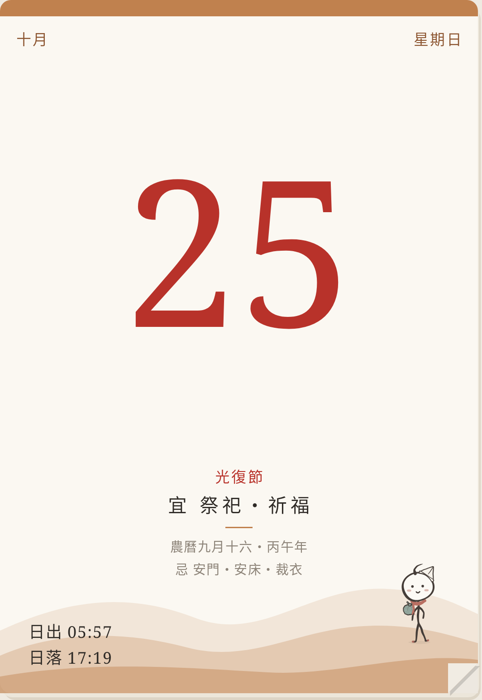

# 墨丸 V3 — P5-3 小工具與 App 日曆頁接上 V3

CI：[Build APK #63](https://github.com/patty60723/tearoff-calendar/actions/runs/40273465266)（commit `cdea758`）。Robolectric 用 App 的程式實際建出小工具（`CalendarWidget.build` → `RemoteViews.apply`）畫的，不是實機截圖。
做法與驗證見 [實作計畫 P5-3](https://github.com/patty60723/tearoff-calendar/blob/feature/mowan-weather-poses/docs/character-implementation-plan.md)。

## 4 種版面：舊火柴人／V3 雨／V3 晴（xxhdpi，今天那頁）

## 8 種天氣（TALL，xxhdpi）

## 不同密度（雨，TALL 與 COMPACT；照實際像素貼上）

小工具的角色 48–64 dp 高，一律用簡化版（D-25：低於 72 dp）；mdpi 是真實的 48–64 px。

## App 日曆頁（V3 完整版，約 80 dp 高）

最上面那張是昨天那頁（今天還沒撕）時不畫天氣，跟日出日落旁的天氣文字一樣。

## Bitmap

- [V3（靜態一張）](bitmap-v3.md)：4 種版面合計 xxhdpi 342 KB、mdpi 38 KB。
- [換 V3 之前的舊火柴人](bitmap-baseline.md)：xxhdpi 2053 KB。
